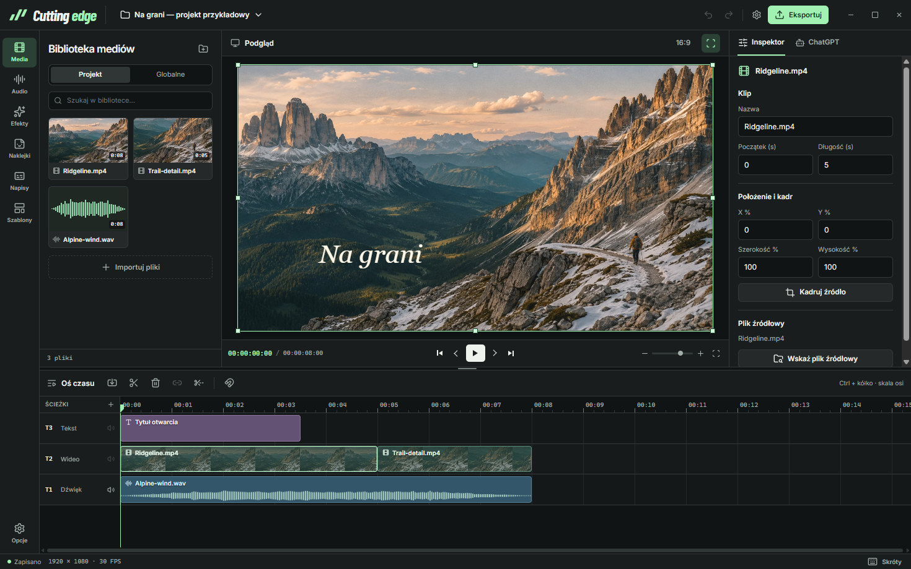

# Cutting edge

Edytor wideo dla Windows x64 z polskim i angielskim interfejsem. Połącz nagranie ekranu z kamerą, usuń ciszę i przygotuj wersję poziomą albo pionową. Projekty, biblioteki i rozpoznawanie mowy działają lokalnie.

[Instalator dla Windows](https://github.com/szymongazinski/Cutting-edge/releases/latest/download/Cutting-edge-Setup-x64.exe) · [Wydania](https://github.com/szymongazinski/Cutting-edge/releases) · [English guide](README.en.md)

## Instalacja

Uruchom instalator, wybierz język, folder projektów i folder gotowych filmów. Aplikację uruchomisz z menu Start pod nazwą **Cutting edge**. Domyślne lokalizacje to Dokumenty → Cutting edge → Projects oraz Wideo → Cutting edge. Instalator oferuje również skojarzenie plików .cutproj.

Możesz zainstalować lub zaktualizować aplikację z PowerShella. Skrypt pobierze bieżące stabilne wydanie, sprawdzi SHA-256 i uruchomi instalator.

~~~powershell
& ([scriptblock]::Create((Invoke-RestMethod 'https://raw.githubusercontent.com/szymongazinski/Cutting-edge/v1.0.3/scripts/install.ps1'))) -Language pl
~~~

Dodaj parametr `-Interactive`, aby otworzyć kreator. Parametry `-ProjectDir` i `-OutputDir` pozwalają podać własne katalogi. W zainstalowanej aplikacji użyj **Opcje → Sprawdź aktualizacje**. Kolejne wydania zastępują program w dotychczasowej lokalizacji.

## Pierwszy montaż

1. Przy pierwszym uruchomieniu otworzy się edytowalny przykład „Na grani”. Kliknij nazwę projektu u góry i wybierz **Nowy projekt**, aby zacząć własny.
2. Upuść pliki w bibliotece mediów. Przeciągnij źródło na wybraną ścieżkę i czas. Dwuklik w bibliotece umieszcza klip przy głowicy. Przeciągnij krawędź klipu, aby skrócić nagranie.
3. Ustaw kamerę i ekran na osobnych ścieżkach. Wyrównaj je na podstawie odsłuchu i przebiegu dźwięku. Zaznacz oba z Ctrl, wybierz **Synchronizuj i utwórz klip złożony** i wpisz dokładne przesunięcia. Dwuklik w klip złożony otwiera jego zawartość.
4. W inspektorze ustaw położenie, kadrowanie, wzmocnienie lub wyciszenie. Polecenie **Kadruj źródło** otworzysz też prawym przyciskiem myszy na obrazie lub filmie w podglądzie i na osi czasu. W podglądzie przeciągnięcie uchwytu na krawędzi przycina obraz, a z wciśniętym Ctrl rozciąga go w jednej osi. Narożniki skalują obraz z zachowaniem proporcji. W **Ustawieniach → Uchwyty krawędzi źródła** możesz zamienić działanie krawędzi i Ctrl. Przełącznik przyciągania na scenie pozwala wyrównywać warstwy do kadru i innych elementów.
5. Użyj **Wytnij ciszę**, aby przeanalizować cały plik z biblioteki, przycięty klip lub klip złożony. Zacznij od −35 dB i 0,40 s. Przed wycięciem zobaczysz liczbę przerw i łączny czas. Cięcie na osi przesuwa razem pozostałe ścieżki. Analiza całego źródła z biblioteki dodaje skróconą wersję na oś.
6. Kliknij **Eksportuj** i wybierz MP4, MOV, MKV lub WebM, rozdzielczość, liczbę klatek i jakość. W **Opcjach** ustawisz wartości domyślne dla nowych projektów. Przy pionowym kadrze podgląd zajmuje prawą stronę okna. Przeciągnij separator, aby zmienić proporcje paneli.

W oknie **Kadrowanie źródła** pracujesz bezpośrednio na dużym podglądzie. Złap bok, żeby uciąć jedną krawędź, albo narożnik, żeby przyciąć obie z zachowaniem proporcji. Kółkiem myszy przybliżysz fragment pod kursorem. Złap obraz wewnątrz ramki i przesuń go w dowolnym kierunku. Strzałki na klawiaturze przesuwają o jeden piksel źródła, a z Shift o dziesięć. W szablonie ramka zachowuje proporcje pola. **Zastosuj kadr** zapisuje wybór.

Projekt zapisuje się automatycznie. Plik .cutproj przechowuje montaż i odwołania do mediów. Po przeniesieniu pliku źródłowego można wskazać jego nowe położenie w inspektorze. Przenosząc projekt na inny komputer, zabierz także użyte nagrania.

## Media globalne, efekty i szablony

W zakładce **Media → Globalne** trzymaj materiały używane w wielu projektach, na przykład gotową czołówkę. Zakładki **Audio**, **Efekty** i **Naklejki** mają własne biblioteki. Możesz importować pliki w aplikacji lub dodać je w Eksploratorze, a następnie odświeżyć bibliotekę. Przycisk folderu otwiera jej katalog.

Dane znajdują się w `%LOCALAPPDATA%\Cutting edge\Library`. W standardowej instalacji ten sam katalog jest dostępny jako **Library** obok pliku wykonywalnego. Podfoldery to `global`, `audiofx`, `visualfx` i `sticker`. Umieść warianty jednej naklejki w podfolderze o nazwie rodziny.

W **Naklejkach** znajdziesz strzałki proste i zakręcone, cienkie i grube. Każda ma dwie animacje do wyboru. Pierwsza porusza całą strzałką, a w drugiej kreska rysuje się od ogona do grotu, zatrzymuje na chwilę i zapętla. Wpisz **rysowana**, żeby wyświetlić te cztery wzory. Biblioteka zawiera też trzy rodzaje kółek oraz podkreślenie pojedyncze i podwójne. Kolor wybierasz na karcie naklejki spośród sześciu wariantów. Aktualizacja z wersji 1.0.0 przenosi jej fabryczne wzory do archiwum. Wcześniejsze projekty nadal mogą z nich korzystać.

Rozciągnięty GIF lub film z biblioteki naklejek i efektów wizualnych odtwarza się w pętli. Klipy wideo importowane jako zwykłe media kończą się wraz ze źródłem.

W **Szablonach** zapisz układ klipów lub utwórz własne pola na obraz, tekst i napisy. Wskaż współrzędne i rozmiar każdego pola. Przy stosowaniu szablonu wybierz media. Dla obrazu większego od pola lub o innych proporcjach otworzy się okno wyboru kadru. Przy generowaniu napisów wskaż zapisane pole.

## Napisy i tekst

**Napisy → Generuj napisy** przyjmuje cały film albo wybrany klip, w tym klip złożony. Wybierz język lub automatyczne wykrywanie, określ ramkę na scenie i wybierz styl. Edytor dobiera jeden rozmiar czcionki dla zestawu, dzieli długie wypowiedzi na krótsze fragmenty i zapisuje plik SRT albo WebVTT w folderze eksportu. W inspektorze możesz edytować tekst, czasy, krój, kolor, obrys i tło. Styl jest widoczny w podglądzie oraz w gotowym filmie. Plik SRT lub WebVTT przenosi tekst i czas wyświetlania.

Rozpoznawanie wykonuje **ListenActive** na tym komputerze. Edytor odnajduje lokalną instalację i korzysta ze wspólnej pamięci modeli. Na nowej maszynie pierwsze użycie może pobrać środowisko ListenActive (około 1,4 GB) i model. Dostępne są large-v3, large-v3-turbo i small. Obsługiwane są GPU NVIDIA i CPU. [Opis integracji i narzędzi](docs/media-tools.md)

**Dodaj tekst** tworzy niezależny tytuł lub podpis z własną czcionką, położeniem i czasem wyświetlania.

## ChatGPT w edytorze

Otwórz kartę **ChatGPT** w inspektorze. Panel korzysta z zainstalowanego klienta Codex i zalogowanego konta ChatGPT. Na komputerze z samodzielnym klientem można zalogować się poleceniem `codex login`. Rozmowa wymaga połączenia z usługą. Do modelu trafiają polecenie, historia rozmowy i opis montażu. Pliki źródłowe pozostają na urządzeniu.

Możesz poprosić o przesunięcie, podział lub wyciszenie klipu, wstawienie tekstu, narysowanie animowanej naklejki lub syntezę efektu dźwiękowego. Asystent może pobrać materiał z podanego adresu HTTPS lub wyszukać go w Wikimedia Commons. Informacje o źródle są zapisywane obok pobranego pliku. Zmiany w montażu wykonane dla jednego polecenia cofniesz jednym Ctrl+Z.

## Skróty

| Czynność | Skrót |
| --- | --- |
| Odtwórz lub zatrzymaj | Spacja |
| Zmień skalę osi wokół kursora | Ctrl + kółko myszy |
| Przyciąganie klipów na osi | M |
| Przyciąganie na scenie | G |
| Podziel klip pod głowicą | S |
| Zaznacz kilka klipów | Ctrl lub Shift + kliknięcie |
| Wybierz zakres | Shift + przeciągnięcie na pustej osi |
| Przejdź o klatkę | ← lub → |
| Cofnij i ponów | Ctrl+Z, Ctrl+Y |
| Nowy projekt, otwórz, zapisz | Ctrl+N, Ctrl+O, Ctrl+S |

## Uruchomienie ze źródeł

Na Windows x64 użyj Node.js 24 i Inno Setup 6. Katalog tools jest przygotowywany ze sprawdzonej lokalnej kopii FFmpeg albo z przypiętego archiwum dystrybucji.

~~~powershell
npm ci
npm run prepare:media
npm start
npm test
npm run test:ui
npm run pack
npm run dist
~~~

Instalator i SHA256SUMS.txt trafiają do katalogu dist. Przy nowej wersji zwiększ numer w package.json i pliku blokady, utwórz tag vX.Y.Z i dodaj oba pliki do stabilnego wydania GitHub. Aktualizator pobiera wydanie wskazane przez releases/latest.

[Licencja programu](LICENSE) · [Licencje składników](THIRD-PARTY.md)
